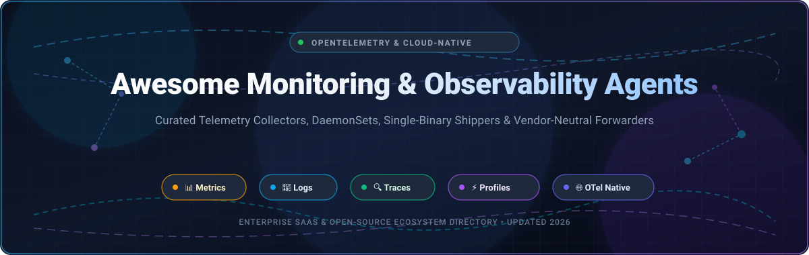

<p align="center">
  
</p>

<p align="center">
  <a href="https://github.com/ishandutta2007/Awesome-Awesome-Awesome"></a>
  <a href="https://discord.gg/jc4xtF58Ve"></a>
  <a href="https://github.com/ishandutta2007/Awesome-Monitoring-Observability-Agents/stargazers"></a>
  <a href="https://github.com/ishandutta2007/Awesome-Monitoring-Observability-Agents/pulls"></a>
  <a href="https://opentelemetry.io/"></a>
  <a href="https://github.com/ishandutta2007/Awesome-Monitoring-Observability-Agents/blob/main/LICENSE"></a>
  <a href="https://github.com/ishandutta2007"></a>
</p>

---

# 🚀 Awesome Monitoring & Observability Agents

> A curated directory of premier **SaaS observability platforms** and **open-source telemetry collectors, forwarders, and agents**. Focused on **OpenTelemetry-native pipelines**, **single-binary edge forwarders**, **Kubernetes DaemonSets**, **eBPF telemetry**, and **vendor-neutral observability architecture**.

Monitoring and observability agents serve as the frontline sensory nervous system for modern IT infrastructure. Operating as daemons, sidecars, or kernel-level eBPF probes across bare-metal hosts, virtual machines, cloud instances, and containerized Kubernetes clusters, these tools harvest the core telemetry signals: **Metrics**, **Logs**, **Traces**, and **Continuous Profiles (M-E-L-T)**. They enrich telemetry streams with dynamic runtime metadata, parse structured and unstructured log lines, aggregate metrics locally, and securely forward telemetry to time-series databases and analytics platforms.

---

## 📑 Table of Contents

- [📈 Sector Overview & Market Dynamics](#-sector-overview--market-dynamics)
- [🏢 Enterprise SaaS & Hosted Observability Platforms](#-enterprise-saas--hosted-observability-platforms)
- [🌐 Open-Source Telemetry Collectors & Agents](#-open-source-telemetry-collectors--agents)
- [🧭 Decision Matrix & Agent Selection Guide](#-decision-matrix--agent-selection-guide)
- [🤝 How to Contribute](#-how-to-contribute)
- [☕ Support](#-support)
- [⭐ Star History](#-star-history)
- [📜 Disclaimer](#-disclaimer)

---

## 📈 Sector Overview & Market Dynamics

The observability and infrastructure monitoring sector represents one of the fastest-growing and highest-retention segments within cloud infrastructure software:

- **Estimated Market Size**: The global observability and IT monitoring software market is valued at **$18.5 Billion to $22.4 Billion in 2024–2026** and is projected to expand to **$35.0 Billion–$42.5 Billion by 2030**, advancing at a robust compound annual growth rate (**CAGR of ~12.5% to 15.2%**). Growth is propelled by multi-cloud complexity, microservice decentralization, container orchestration, and surging demand for AI-driven anomaly detection (AIOps).
- **Market Structure & Concentration**: The sector exhibits a **moderately fragmented structure anchored by an oligopolistic enterprise tier**. Market leaders such as **Datadog**, **Dynatrace**, and **Cisco/Splunk** capture substantial enterprise budget share through consolidated single-pane-of-glass platforms and proprietary agent capabilities. However, this is **not a "winner-take-all" market**: the rapid industry-wide convergence on the **CNCF OpenTelemetry (OTel)** open standard has decoupled telemetry generation from proprietary backends. This shift empowers platform engineering teams to deploy lightweight, vendor-neutral collectors (e.g., OpenTelemetry Collector, Grafana Alloy, Vector, Fluent Bit) and switch analytics backends seamlessly without vendor lock-in.

---

## 🏢 Enterprise SaaS & Hosted Observability Platforms

Enterprise observability vendors deliver fully managed backends combined with intelligent, auto-instrumenting agents capable of zero-configuration infrastructure discovery, distributed APM tracing, and AI-assisted root cause analysis.

### 📊 SaaS Comparison Matrix

*The table below ranks enterprise SaaS observability vendors sorted descending by company market valuation / scale:*

| # | Platform / Agent | Company Valuation / Scale 🏢 | Starting Tier Pricing 💳 | Free Tier / Trial Quota Limits 🎁 | Key Telemetry Capabilities ⚡ |
|---|------------------|------------------------------|--------------------------|-----------------------------------|-------------------------------|
| 1 | **[Datadog Agent](https://www.datadoghq.com/)** | **~$40.0 Billion** Market Cap (NASDAQ: DDOG \| ~$2.68B ARR) | **$15.00/host/month** (Pro plan, billed annually) or **$18.00/host/month** (On-demand); APM starts at **$31.00/host/month** | **Free Forever plan up to 5 hosts** (1-day metric retention, standard dashboards, host map) OR **14-day full enterprise free trial** (unlimited hosts, no credit card required) | Bundles Datadog Distribution of OpenTelemetry Collector (DDOT), v3 intake compression, eBPF network monitoring, continuous profiling |
| 2 | **[Splunk Observability / Universal Forwarder](https://www.splunk.com/)** (Cisco) | **$28.0 Billion** Acquisition Valuation (Parent Cisco: ~$220B+ Market Cap \| $3.8B+ ARR) | **$15.00/host/month** (Infrastructure Monitoring, annual billing) or **$65.00/host/month** (Full APM with AlwaysOn Profiling) | **14-day free trial** with complete platform access (up to 250 hosts/containers and 10 GB ingested telemetry data; no credit card required) | Splunk Universal Forwarder & Splunk OTel Collector; petabyte-scale log routing, real-time enterprise streaming pipelines, full-fidelity distributed tracing |
| 3 | **[Dynatrace OneAgent](https://www.dynatrace.com/)** | **~$15.0 Billion** Market Cap (NYSE: DT \| ~$1.43B ARR) | **$0.04/hour per 8 GiB host** (~$29.20/host/month for Infrastructure Monitoring) or **$0.08/hour per 8 GiB host** (~$58.40/host/month for Full-Stack APM) | **15-day free trial** with full platform capabilities (includes 1,000 host-hours, automatic OneAgent discovery, and Davis AI causal engine; no credit card required) | Single binary zero-code auto-injection, deep bytecode instrumentation, automated topology mapping (Smartscape), code-level vulnerability scanning |
| 4 | **[Elastic Cloud / Elastic Agent](https://www.elastic.co/)** | **~$9.5 Billion** Market Cap (NYSE: ESTC \| ~$1.27B ARR) | **$95.00/month** (Standard managed cluster starting at ~$0.13/hour on AWS, GCP, or Azure) | **14-day free trial** on Elastic Cloud (full access to Platinum enterprise features including Elastic Agent Fleet Manager, APM Server, and ML anomaly detection) | Unified Elastic Agent centrally managed via Elastic Fleet; combines Beats capabilities with native Lucene indexing, eBPF system tracing, and endpoint security |
| 5 | **[New Relic Agent](https://newrelic.com/)** | **$6.5 Billion** Acquisition Valuation (Francisco Partners & TPG \| ~$1.0B ARR) | **$49.00/core user/month** (Standard plan) + **$0.35 per additional GB** of data ingested beyond free tier allowance | **Free Forever plan: 100 GB/month data ingest**, 1 full platform user, unlimited basic users, 30+ capabilities included (no credit card required) | Language-specific APM auto-instrumentation SDKs, infrastructure agent, Pixie eBPF Kubernetes observability, native OpenTelemetry ingest endpoints |
| 6 | **[Grafana Cloud / Grafana Alloy](https://grafana.com/products/cloud/)** | **~$6.0 Billion** Private Valuation (Series D \| ~$150M+ ARR) | **$29.00/month base** (Pro plan) + usage ($5.60 per 1,000 active metric series, $0.50/GB logs, $0.50/GB traces) | **Free Forever plan: 10,000 active metric series**, 50 GB logs, 50 GB traces, 50 GB continuous profiles, 3 user seats, 14-day data retention | Native orchestration for Grafana Alloy, managed Prometheus time-series (Mimir), log aggregation (Loki), distributed tracing (Tempo), and profiling (Pyroscope) |
| 7 | **[Sumo Logic OTel Collector](https://www.sumologic.com/)** | **$1.7 Billion** Acquisition Valuation (Francisco Partners \| ~$300M+ ARR) | **$2.75 per GB** (Essentials log analytics tier; $3.00/GB on-demand) or **$0.10/host/hour** for infrastructure monitoring | **30-day free trial** (up to 1 GB/day ingest with enterprise security & observability analytics) transitioning into **Sumo Logic Free** (1 GB/day ingest, 4 active days retention) | Turnkey OpenTelemetry collector distribution, cloud-native log parsing, real-time security analytics, multi-tenant automated root-cause detection |

---

## 🌐 Open-Source Telemetry Collectors & Agents

The open-source monitoring agent ecosystem offers battle-tested collectors and high-throughput forwarders that prevent vendor lock-in and minimize compute overhead.

*Projects are ordered descending by their GitHub Stargazer count:*

### 1. 🌟 [Netdata](https://github.com/netdata/netdata) [](https://github.com/netdata/netdata/stargazers)
- **Primary Focus**: Real-time, per-second infrastructure monitoring and diagnostics.
- **License**: GPL-3.0 | **Primary Language**: C / Go / Python
- **Key Capabilities**:
  - Extremely lightweight real-time agent requiring minimal CPU overhead (~1%) and zero configuration.
  - Monitors thousands of system metrics per second out-of-the-box: CPU, RAM, disk I/O, network sockets, systemd services, containers, and applications.
  - Features an embedded lockless in-memory time-series database and an instant local web dashboard.
  - Native alert engine with 20+ notification integrations (Slack, PagerDuty, Discord, Email).

### 2. 🌟 [Glances](https://github.com/nicolargo/glances) [](https://github.com/nicolargo/glances/stargazers)
- **Primary Focus**: Cross-platform system telemetry and lightweight monitoring daemon.
- **License**: LGPL-3.0 | **Primary Language**: Python
- **Key Capabilities**:
  - Operates in standalone terminal CLI mode, client/server mode, or headless web server mode via REST API.
  - Dynamic visual indicators for hardware utilization, Docker/Podman container stats, GPU metrics, and processes.
  - Exports collected telemetry to backends including InfluxDB, Prometheus, OpenSearch, Kafka, and CSV.

### 3. 🌟 [SigNoz](https://github.com/SigNoz/signoz) [](https://github.com/SigNoz/signoz/stargazers)
- **Primary Focus**: Full-stack OpenTelemetry-native application performance monitoring (APM).
- **License**: Apache-2.0 / BSL | **Primary Language**: Go / TypeScript
- **Key Capabilities**:
  - Direct native integration with OpenTelemetry instrumentation across Java, Python, Go, Node.js, and .NET.
  - Combines metrics, distributed traces, and log streams inside an intuitive unified UI backed by ClickHouse.
  - Offers custom dashboarding, automated anomaly detection, service dependency maps, and p99 latency breakdowns.

### 4. 🌟 [Vector](https://github.com/vectordotdev/vector) [](https://github.com/vectordotdev/vector/stargazers)
- **Primary Focus**: Ultra-high-throughput, memory-safe observability data pipeline agent.
- **License**: MPL-2.0 | **Primary Language**: Rust
- **Key Capabilities**:
  - Engineered in Rust to deliver orders-of-magnitude faster throughput with deterministic memory bounds.
  - Native Vector Remap Language (VRL) for real-time log transformation, field enrichment, and compliance data scrubbing.
  - Connects hundreds of inputs (Kafka, syslog, files, AWS S3) to dozens of downstream backends (OpenTelemetry, Elasticsearch, Datadog, ClickHouse).

### 5. 🌟 [cAdvisor](https://github.com/google/cadvisor) [](https://github.com/google/cadvisor/stargazers)
- **Primary Focus**: Container resource analysis and performance telemetry.
- **License**: Apache-2.0 | **Primary Language**: Go
- **Key Capabilities**:
  - Built by Google; serves as the foundational container metrics collector baked directly into the Kubernetes Kubelet.
  - Automatically discovers all running containers and measures resource isolation, memory limits, and network stats.
  - Exposes native Prometheus format endpoints for node-level container scrape targets.

### 6. 🌟 [VictoriaMetrics (vmagent)](https://github.com/VictoriaMetrics/VictoriaMetrics) [](https://github.com/VictoriaMetrics/VictoriaMetrics/stargazers)
- **Primary Focus**: Lightweight Prometheus-compatible metric scraper and router agent.
- **License**: Apache-2.0 | **Primary Language**: Go
- **Key Capabilities**:
  - `vmagent` provides a dedicated, low-footprint metric collector that replaces Prometheus scrapers in edge networks.
  - Ingests Prometheus, InfluxDB, Graphite, OpenTelemetry, and DataDog formatted metrics.
  - Built-in on-disk buffering ensures zero metric loss during network outages or upstream maintenance windows.

### 7. 🌟 [Telegraf](https://github.com/influxdata/telegraf) [](https://github.com/influxdata/telegraf/stargazers)
- **Primary Focus**: Plugin-driven server agent for collecting and reporting metrics.
- **License**: MIT | **Primary Language**: Go
- **Key Capabilities**:
  - Standalone static binary with 300+ community and enterprise plugins.
  - Deep coverage across industrial protocols (OPC UA, Modbus), cloud APIs, databases (PostgreSQL, MySQL), and IoT message brokers (MQTT).
  - Clean TOML-based declarative configuration with processor and aggregator pipelines.

### 8. 🌟 [Node Exporter](https://github.com/prometheus/node_exporter) [](https://github.com/prometheus/node_exporter/stargazers)
- **Primary Focus**: Kernel and hardware metrics collector for Linux/Unix machines.
- **License**: Apache-2.0 | **Primary Language**: Go
- **Key Capabilities**:
  - The universal gold standard for scraping OS-level hardware and kernel metrics in the Prometheus ecosystem.
  - Collects non-invasive system counters: CPU frequency, filesystem saturation, memory pressure (PSI), network socket queues, and thermal limits.
  - Extensible via custom textfile collector scripts.

### 9. 🌟 [Fluentd](https://github.com/fluent/fluentd) [](https://github.com/fluent/fluentd/stargazers)
- **Primary Focus**: Unified logging layer and event aggregator.
- **License**: Apache-2.0 | **Primary Language**: Ruby / C
- **Key Capabilities**:
  - CNCF graduated project establishing structured JSON log normalization across large enterprise deployments.
  - Rich plugin repository with 1,000+ connectors for legacy storage, message queues, and cloud warehouses.
  - Robust buffering and failover mechanisms ensuring reliable log transmission.

### 10. 🌟 [Elastic Beats](https://github.com/elastic/beats) [](https://github.com/elastic/beats/stargazers)
- **Primary Focus**: Lightweight single-purpose data shippers for the Elastic Stack.
- **License**: Elastic-2.0 / SSPL | **Primary Language**: Go
- **Key Capabilities**:
  - Dedicated lightweight binary shippers: **Filebeat** (log lines), **Metricbeat** (system/service counters), **Packetbeat** (network packets), **Heartbeat** (uptime pinging).
  - Built-in ingestion modules with pre-packaged dashboards for NGINX, Apache, Kafka, Systemd, and Kubernetes.
  - Seamless backpressure management and direct ingestion into Elasticsearch and Logstash.

### 11. 🌟 [Fluent Bit](https://github.com/fluent/fluent-bit) [](https://github.com/fluent/fluent-bit/stargazers)
- **Primary Focus**: Lightweight, high-performance telemetry agent for logs, metrics, and traces.
- **License**: Apache-2.0 | **Primary Language**: C
- **Key Capabilities**:
  - Industry champion for minimal CPU and memory footprint (< 10 MB RAM), deployed billions of times in Kubernetes clusters globally.
  - Built-in SQL stream processing for on-the-fly filtering, data enrichment, and transformation.
  - 100+ native plugins with TLS/SSL encryption, async I/O, and native OpenTelemetry ingestion and emission.

### 12. 🌟 [OpenTelemetry Collector](https://github.com/open-telemetry/opentelemetry-collector) [](https://github.com/open-telemetry/opentelemetry-collector/stargazers)
- **Primary Focus**: CNCF vendor-agnostic proxy and pipeline processor for OTel telemetry signals.
- **License**: Apache-2.0 | **Primary Language**: Go
- **Key Capabilities**:
  - The universal industry standard for ingesting, transforming, and exporting metrics, logs, and traces.
  - Decouples application instrumentation from vendors; switch backends by updating pipeline YAML without code changes.
  - `otelcol-contrib` distribution features hundreds of community receivers, tail-based sampling processors, and multi-destination exporters.

### 13. 🌟 [Grafana Alloy](https://github.com/grafana/alloy) [](https://github.com/grafana/alloy/stargazers)
- **Primary Focus**: Vendor-neutral distribution of OpenTelemetry Collector with native Grafana ecosystem pipelines.
- **License**: Apache-2.0 | **Primary Language**: Go
- **Key Capabilities**:
  - Combines the best of Prometheus Agent, Promtail, Grafana Agent Flow, and OpenTelemetry Collector into a single unified binary.
  - Native pipelines for Prometheus metrics, OpenTelemetry, Loki logs, Tempo traces, and Pyroscope continuous profiling.
  - Enterprise fleet clustering and dynamic configuration reloading via Grafana Fleet Management.

---

## 🧭 Decision Matrix & Agent Selection Guide

Selecting the appropriate agent architecture depends on your workload constraints, target telemetry signals, and infrastructure topology:

```
                           What is your primary collection goal?
                                             │
             ┌───────────────────────────────┼───────────────────────────────┐
             │                               │                               │
    [System & Hardware]              [Unified OTel Pipelines]       [High-Throughput Logs]
             │                               │                               │
      Is it real-time?              Need fleet management?             Ultra-low RAM?
      ┌──────┴──────┐                 ┌──────┴──────┐                 ┌──────┴──────┐
     Yes            No               Yes            No               Yes            No
      │              │                │              │                │              │
   Netdata     Node Exporter    Grafana Alloy   OTel Collector   Fluent Bit        Vector
```

- **For Enterprise All-in-One Turnkey**: Choose **Datadog Agent** or **Dynatrace OneAgent** if you require zero-configuration auto-instrumentation, full-stack tracing, and consolidated commercial support.
- **For OpenTelemetry Native Pipelines**: Deploy **OpenTelemetry Collector** or **Grafana Alloy** as a Kubernetes DaemonSet or central gateway to achieve vendor-neutral multi-signal routing.
- **For High-Volume Log Shipping**: Use **Fluent Bit** when container node memory is strictly capped (< 15 MB RAM per node) or **Vector** for high-volume transformational pipelines with custom VRL scripts.
- **For Linux Kernel & Machine Metrics**: Pair **Node Exporter** with Prometheus or deploy **Telegraf** for specialized hardware, IoT, and database metrics.

---

## 🤝 How to Contribute

Contributions to expand and update this ecosystem guide are warmly encouraged:

1. **Fork the Repository** on GitHub.
2. **Add or Edit Entries** in [README.md](file:///C:/Users/hp/Documents/Projects/Awesome-Monitoring-Observability-Agents/README.md) following the established tabular and list structures.
3. **Verify Data**: Ensure pricing, free tier limits, star badges, and links are accurate and factual.
4. **Submit a Pull Request** with a concise description of your additions.

---

## ☕ Support

If you find this curated directory useful for your infrastructure architecture, platform engineering, or SRE journey, please consider showing your support:

- ⭐ **Star this repository** to help other engineers discover it.
- 🍴 **Fork and share** with your DevOps and SRE teams.
- ☕ **Sponsor the Maintainer**: Support ongoing open-source curation and development via the [GitHub Sponsor Dashboard](https://github.com/sponsors/ishandutta2007).

---

## ⭐ Star History

[](https://star-history.dera.page/#ishandutta2007/Awesome-Monitoring-Observability-Agents&type=date&legend=top-left)

---

## 📜 Disclaimer

- This is a community-curated technical directory for informational and educational purposes.
- Product names, trademarks, and logos belong to their respective corporate entities.
- Observability agent resource requirements and SaaS vendor pricing fluctuate; always review official vendor documentation for up-to-date production tier agreements.
